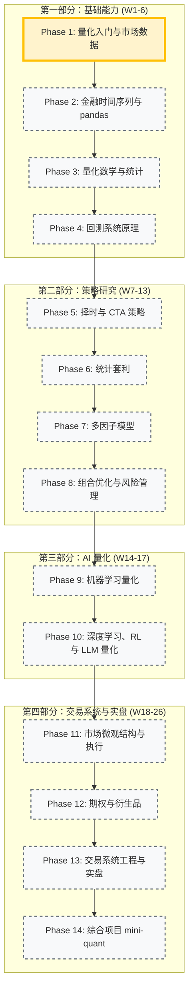
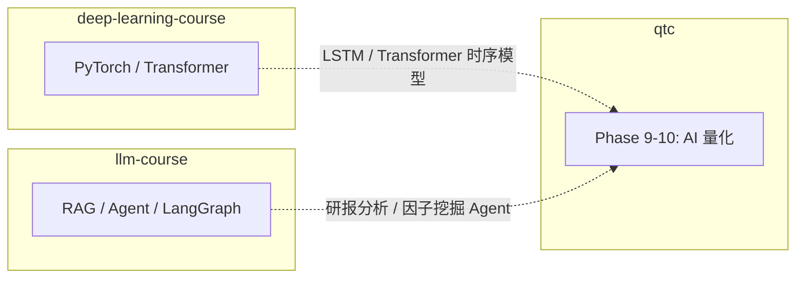

# 🗺️ 量化交易课程路线图

> **当前状态**: 🚀 准备开始第 1 阶段 (量化入门与市场数据)
> **总体进度**: 0% (完成 0/14 阶段)

## 📅 学习路径概览



---

## 🎯 两条职业主线

课程前 13 周是公共基础，之后研究与交易两条线都学，在综合项目中汇合：

```
                        ┌──► 策略研究员线：P7 多因子 → P8 组合优化 → P9/P10 AI 量化
P1-P4 基础 ─► P5/P6 策略 ┤                                                        ├──► P14 mini-quant
                        └──► 交易员/开发线：P11 微观结构 → P12 期权 → P13 实盘系统
```

---

## 📍 详细里程碑

### ⏳ 第一部分：基础能力 (Phase 1-4)

拿到干净的数据，看懂收益与风险，搭出可信的回测。

#### Phase 1: 量化入门与市场数据（W1）

- [ ] 量化行业全景与岗位
- [ ] A 股交易规则与交易成本
- [ ] AKShare / Tushare / ccxt 数据获取
- [ ] 复权、交易日历、数据存储与质量
- [ ] **实战**: 本地行情数据仓库

#### Phase 2: 金融时间序列与 pandas（W2）

- [ ] 收益率口径与年化
- [ ] 滚动窗口、重采样、多资产面板
- [ ] 技术指标与回撤分析
- [ ] **实战**: 股票分析仪表板

#### Phase 3: 量化数学与统计（W3-4）

- [ ] 概率分布、肥尾、假设检验
- [ ] 蒙特卡洛与凯利公式
- [ ] 回归、协整、平稳性、ARMA/GARCH
- [ ] **实战**: 风险收益统计报告生成器

#### Phase 4: 回测系统原理（W5-6）

- [ ] 向量化回测与事件驱动回测
- [ ] 绩效指标、交易成本、A 股约束
- [ ] 前视偏差、过拟合、Walk-Forward
- [ ] **实战**: 自研迷你回测引擎

### 🔬 第二部分：策略研究 (Phase 5-8)

#### Phase 5: 择时与 CTA 策略（W7-8）

- [ ] 均线、布林带、MACD/RSI、通道突破、海龟
- [ ] 期货合约展期与主力连续
- [ ] ATR 仓位管理、参数稳健性
- [ ] **实战**: 期货 CTA 多品种组合

#### Phase 6: 统计套利（W9）

- [ ] 配对交易与协整
- [ ] 卡尔曼滤波动态对冲
- [ ] 跨期 / 期现 / 资金费率套利
- [ ] **实战**: 配对交易系统

#### Phase 7: 多因子模型（W10-11）

- [ ] CAPM、Fama-French、Barra
- [ ] 因子构建、预处理、IC/IR、分层回测
- [ ] 财报 Point-in-Time、因子合成
- [ ] **实战**: A 股多因子选股

#### Phase 8: 组合优化与风险管理（W12-13）

- [ ] 均值方差、风险平价、Black-Litterman、HRP
- [ ] 协方差收缩、VaR/CVaR、压力测试
- [ ] 绩效归因与换手控制
- [ ] **实战**: 组合优化与风控模块

### 🤖 第三部分：AI 量化 (Phase 9-10)

#### Phase 9: 机器学习量化（W14-15）

- [ ] 特征工程、Triple-Barrier 标签
- [ ] Purged K-Fold、LightGBM、SHAP
- [ ] Deflated Sharpe、Qlib 工作流
- [ ] **实战**: ML 选股模型

#### Phase 10: 深度学习、RL 与 LLM 量化（W16-17）

- [ ] LSTM / Transformer 时序预测
- [ ] 强化学习交易环境与智能体
- [ ] 新闻情绪、研报分析、LLM 因子挖掘
- [ ] **实战**: LLM 因子研究助手

### ⚙️ 第四部分：交易系统与实盘 (Phase 11-14)

#### Phase 11: 市场微观结构与执行（W18-19）

- [ ] 订单簿、tick 与 Level-2 数据
- [ ] 冲击成本、TWAP/VWAP、Almgren-Chriss
- [ ] 做市模型 Avellaneda-Stoikov
- [ ] **实战**: 加密订单簿做市模拟器

#### Phase 12: 期权与衍生品（W20）

- [ ] BS 定价与希腊字母
- [ ] 隐含波动率与波动率曲面
- [ ] Delta 对冲与波动率策略
- [ ] **实战**: 期权定价与波动率曲面工具

#### Phase 13: 交易系统工程与实盘（W21-23）

- [ ] 事件驱动架构、OMS、风控引擎
- [ ] vn.py + CTP、QMT/掘金、ccxt 实盘接口
- [ ] 监控告警、对账恢复、Docker 部署
- [ ] **实战**: 多市场实盘交易系统

#### Phase 14: 综合项目（W24-26）

- [ ] mini-quant 量化平台
- [ ] 研究报告写作
- [ ] 量化岗位面试准备
- [ ] **实战**: mini-quant 量化平台

---

## 🏆 实战项目规划

| 项目                     | 对应阶段 | 核心技术点                  | 状态      |
| :----------------------- | :------- | :-------------------------- | :-------- |
| **本地行情数据仓库**     | Phase 1  | AKShare, Parquet, DuckDB    | ⏳ 待开始 |
| **股票分析仪表板**       | Phase 2  | pandas, 技术指标, 可视化    | ⏳ 待开始 |
| **风险收益统计报告**     | Phase 3  | 统计检验, GARCH, 蒙特卡洛   | ⏳ 待开始 |
| **迷你回测引擎**         | Phase 4  | 事件驱动, 撮合, 绩效        | ⏳ 待开始 |
| **期货 CTA 组合**        | Phase 5  | 趋势跟踪, 展期, ATR 仓位    | ⏳ 待开始 |
| **配对交易系统**         | Phase 6  | 协整, 卡尔曼滤波            | ⏳ 待开始 |
| **A 股多因子选股**       | Phase 7  | 因子 IC, 中性化, 分层回测   | ⏳ 待开始 |
| **组合优化与风控模块**   | Phase 8  | cvxpy, 风险平价, VaR        | ⏳ 待开始 |
| **ML 选股模型**          | Phase 9  | LightGBM, Purged CV, Qlib   | ⏳ 待开始 |
| **LLM 因子研究助手**     | Phase 10 | LLM Agent, 情绪因子         | ⏳ 待开始 |
| **做市模拟器**           | Phase 11 | 订单簿, AS 模型             | ⏳ 待开始 |
| **期权工具箱**           | Phase 12 | BS, 希腊字母, 波动率曲面    | ⏳ 待开始 |
| **多市场实盘交易系统**   | Phase 13 | vn.py, CTP, ccxt, 风控      | ⏳ 待开始 |
| **mini-quant 量化平台**  | Phase 14 | 综合                        | ⏳ 待开始 |

---

## 🔗 与其他课程的关系



---

> _此路线图基于 `LEARNING_PLAN.md` 生成，随学习进度动态更新。_
